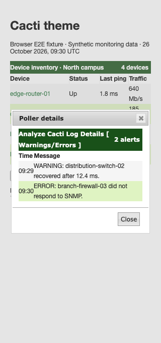

# Cacti theme validation

The Cacti theme keeps wrapped table titles and their controls inside the
titlebar. Ordinary text links retain at least 4.5:1 contrast against white and
alternating table rows, including keyboard focus, hover, and active states.

## Seeded browser E2E fixture

The screenshots use `tests/fixtures/Ui/cacti-theme.html` with synthetic device
names, ping times, traffic measurements, and poller alerts. They show rendered
components using the repository's stylesheets and jQuery UI. They do not show
a live installation or production monitoring data.


At a 320px viewport, the details title wraps while the titlebar continues to
contain the alert count and the content starts below it.



## Reproduce

From the repository root, with Node.js 22 selected through mise:

```sh
cd tests/e2e
mise exec node@22 -- npm ci --ignore-scripts
mise exec node@22 -- npx --no-install playwright install chromium
CACTI_THEME_COVERAGE=1 mise exec node@22 -- npx --no-install playwright test \
  tests/develop-theme-correctness.spec.ts tests/develop-theme-cleanup.spec.ts --project=chromium
```

Set `UPDATE_THEME_SCREENSHOTS=1` on that test command to regenerate the two
committed screenshots. Normal runs attach screenshots to the test results.
The seeded fixture test opens and closes the real jQuery UI details dialog
and follows a device link. Other regressions cover short, wrapped, and
unbroken titles at 320, 390, and 1280px.

After committing a change, measure changed CSS line coverage from the root:

```sh
mise exec python@3.12 -- python tests/tools/report_changed_coverage.py \
  --base origin/develop --language css --minimum 100 \
  --browser-root tests/e2e/test-results
```

This measures executed changed CSS lines. It does not measure whole-project
coverage or prove visual correctness on every browser and page.
