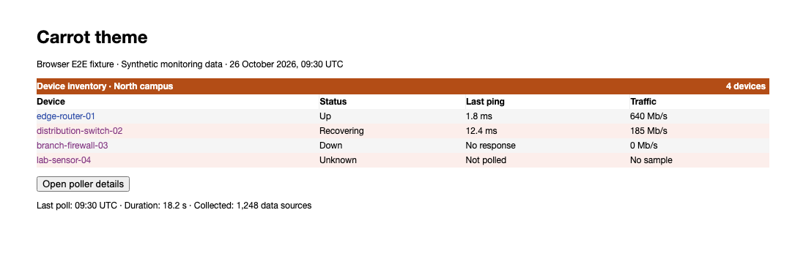
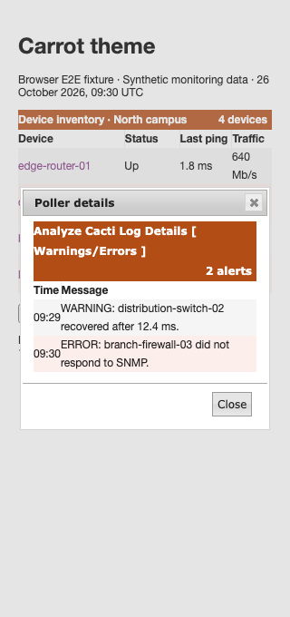

# Carrot theme validation

Carrot retains its orange, coral, and purple palette with contrasting text on
light rows, titlebars, navigation selections, active controls, and highlighted
select2 options. Text contrast is checked against the computed background,
including translucent colors and ancestor surfaces.

## Seeded browser E2E fixture

These screenshots reuse `tests/fixtures/Ui/cacti-theme.html` with the real
Carrot stylesheets and jQuery UI. The device names, ping times, traffic values,
and poller alerts are synthetic data. They do not show a live installation.



The E2E test follows a device link and opens and closes the details dialog at a
320px viewport. Carrot's existing wrapping behavior is retained.



## Reproduce

Follow the browser dependency setup in [Cacti theme validation](cacti-theme.md).
From `tests/e2e`, run:

```sh
CACTI_THEME_COVERAGE=1 mise exec node@22 -- npx --no-install playwright test \
  tests/develop-theme-correctness.spec.ts tests/develop-theme-cleanup.spec.ts --project=chromium
```

Set `UPDATE_THEME_SCREENSHOTS=1` to regenerate the committed images. Normal
runs attach the screenshots to the test results. Link regressions cover
white, odd, even, selected, and selectable rows in default, focus, hover, and
active states. Separate assertions cover titlebar text, navigation selections,
active buttons, and highlighted select2 options.

After committing, require complete coverage of changed CSS lines from the root:

```sh
mise exec python@3.12 -- python tests/tools/report_changed_coverage.py \
  --base fix/cacti-theme-contrast-and-titlebars --language css --minimum 100 \
  --browser-root tests/e2e/test-results
```

The base shown above is the parent fix branch while this PR is stacked. Use
`origin/develop` after the parent merges. Coverage measures executed changed
CSS lines, not whole-project coverage or every possible visual state.
