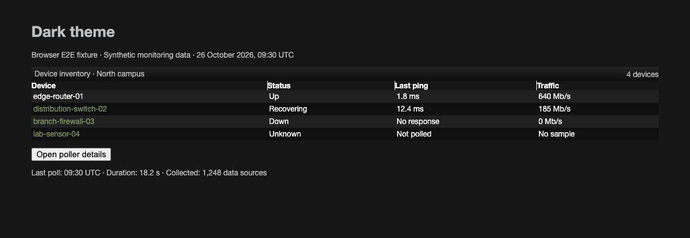
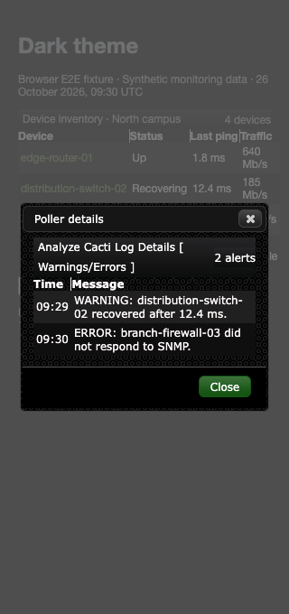

# Dark theme validation

Dark provides visible keyboard focus, keeps wrapped titles inside their bars,
and uses legible hover text against its green row gradients. Short titlebars
retain a 22px minimum height. Native title spans can wrap instead of forcing
their text outside a fixed-height element.

## Seeded browser E2E fixture

The screenshots use the real Dark stylesheets and jQuery UI with the shared
device fixture. Device names, ping times, traffic values, and poller alerts
are synthetic data, not production monitoring output.



The browser test follows a device link, opens the details dialog at 320px,
checks the alert data and title geometry, and closes the dialog.



## Reproduce

Use the dependency setup in [Cacti theme validation](cacti-theme.md). From
`tests/e2e`, run the existing theme suite with Node.js 22 selected through mise:

```sh
CACTI_THEME_COVERAGE=1 mise exec node@22 -- node node_modules/@playwright/test/cli.js test \
  tests/develop-theme-correctness.spec.ts tests/develop-theme-cleanup.spec.ts --project=chromium
```

Set `UPDATE_THEME_SCREENSHOTS=1` to regenerate the committed images. Normal runs
attach screenshots to the test results. Regression cases cover title spans at
320, 390, and 1280px, keyboard navigation through four control types, forced
colors, and link states on normal, selectable, and selected rows.

Contrast assertions composite translucent foregrounds and backgrounds and
check all linear-gradient stops. Raster textures use their fallback colors.
These tests do not establish contrast for arbitrary background images.

After committing, require complete changed CSS line coverage from the root:

```sh
mise exec python@3.12 -- python tests/tools/report_changed_coverage.py \
  --base fix/carrot-theme-contrast --language css --minimum 100 \
  --browser-root tests/e2e/test-results
```

The base is the parent theme branch while this PR is stacked; use
`origin/develop` after the parent merges. This measures executed changed CSS
lines, not whole-project coverage or live-installation behavior.
