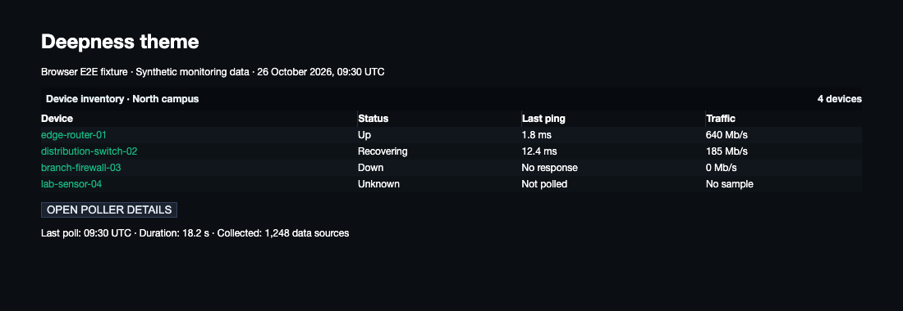
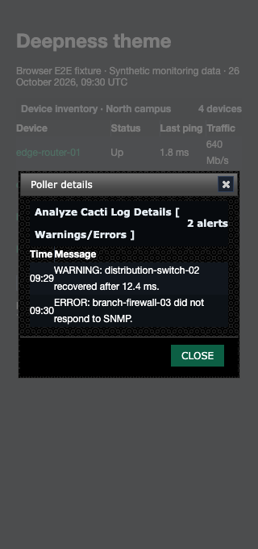

# Deepness theme validation

Deepness titles wrap beside their controls, keeping long details headings inside
the titlebar. Short titlebars retain their 28px height. Status and import messages
use foregrounds that remain readable on alternating, selected, and hovered rows.

## Populated browser fixtures

The browser tests load the real Deepness stylesheets and jQuery UI. Device names,
ping times, traffic, and poller alerts are synthetic monitoring data. These are
fixture screenshots, not a live installation.



The test follows a device link, opens the poller details dialog at 320px, checks
the alert messages, and closes the dialog.



## Reproduce

Follow the dependency setup in [Cacti theme validation](cacti-theme.md), then run
from `tests/e2e`:

```sh
CACTI_THEME_COVERAGE=1 mise exec node@22 -- node node_modules/@playwright/test/cli.js test \
  tests/develop-theme-correctness.spec.ts tests/develop-theme-cleanup.spec.ts --project=chromium
```

Set `UPDATE_THEME_SCREENSHOTS=1` to regenerate the committed screenshots.
The tests check native title spans at 320, 390, and 1280px, including unbroken
text. Text rectangles must stay inside the bar and clear of the controls.
Status and import messages must meet 4.5:1 contrast on normal, alternating,
selected, and hovered rows. Link states also run through the shared contrast
checks. Gradient stops and alpha colors are included; arbitrary image backgrounds
are not measured.

After committing, run the changed CSS coverage gate from the repository root:

```sh
mise exec python@3.12 -- python tests/tools/report_changed_coverage.py \
  --base fix/dark-theme-accessibility --language css --minimum 100 \
  --browser-root tests/e2e/test-results
```

This PR extends the existing theme test harness and is stacked above the Dark
fix. Use `origin/develop` after the lower layers merge. Coverage measures executed
changed CSS lines, not whole-project or branch coverage.
