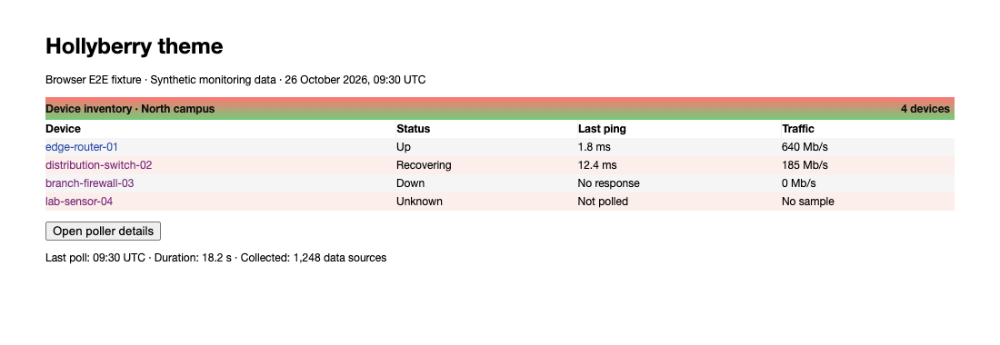
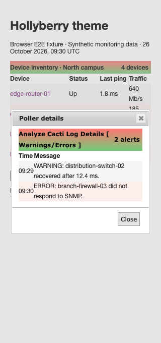

# Hollyberry theme validation

Hollyberry titles wrap beside their controls, keeping long headings inside the
bar. Short titlebars retain their 25px height. Links, title text, selected rows,
navigation selections, and active controls use readable foregrounds. The affected
gradients use lighter colors where dark text needs more contrast.

## Populated browser fixtures

The screenshots use real Hollyberry stylesheets and jQuery UI with synthetic
device names, response times, traffic values, and poller alerts. They show browser
fixtures, not a live installation.



The browser test follows a device link, opens the details dialog at 320px,
checks its alert messages and title geometry, and closes it.



## Reproduce

Use the dependency setup in [Cacti theme validation](cacti-theme.md), then run
from `tests/e2e`:

```sh
CACTI_THEME_COVERAGE=1 mise exec node@22 -- node node_modules/@playwright/test/cli.js test \
  tests/develop-theme-correctness.spec.ts tests/develop-theme-cleanup.spec.ts --project=chromium
```

Set `UPDATE_THEME_SCREENSHOTS=1` to regenerate committed screenshots.
The suite checks native title spans at 320, 390, and 1280px, including unbroken
text. It tests link rest/focus/hover/active states on normal, alternating,
selectable, and selected rows, plus navigation, tab, and active-control text.

Contrast checks composite alpha colors and sample each sRGB gradient segment
at its endpoints and quarter points. The red-to-green interior regression catches
contrast failures that checking endpoints alone misses. Sampling does not prove
contrast at every pixel, and raster images use their fallback colors.

After committing, measure changed CSS line coverage from the repository root:

```sh
mise exec python@3.12 -- python tests/tools/report_changed_coverage.py \
  --base fix/deepness-theme-accessibility --language css --minimum 100 \
  --browser-root tests/e2e/test-results
```

This PR extends the shared title geometry and contrast tests above the Deepness
layer in the native theme stack. Use `origin/develop` after the lower layers merge.
The gate measures executed changed CSS lines, not whole-project or branch coverage.
