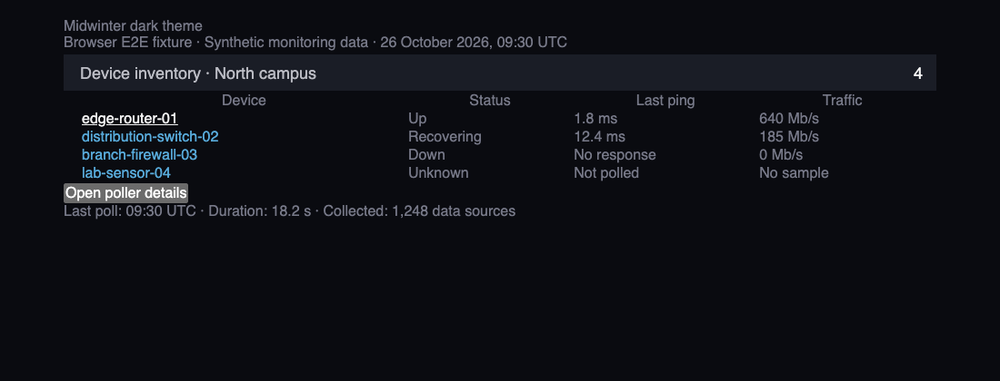
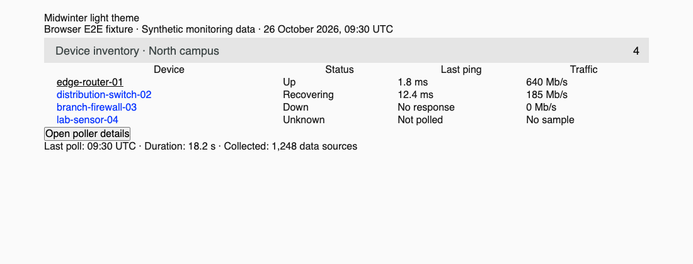
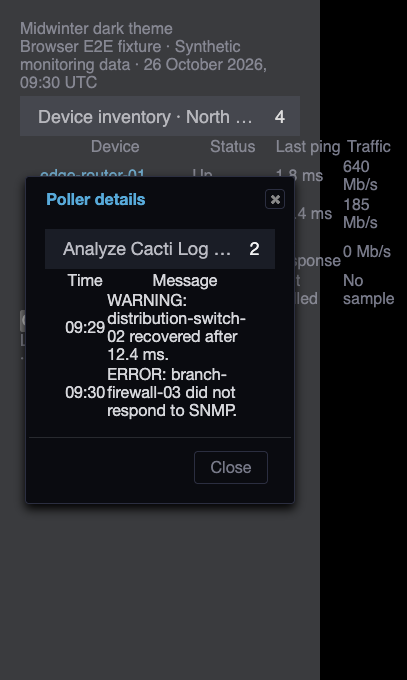
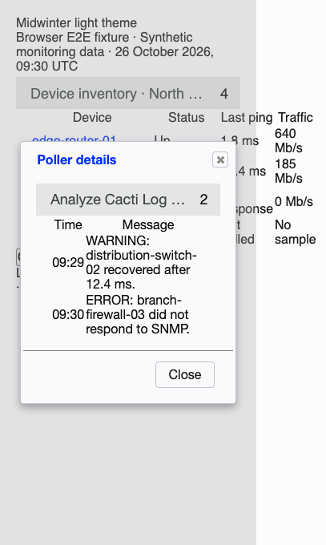

# Midwinter theme validation

Midwinter details titles retain their ellipsis behavior while controls stay
beside them. The titlebar can grow to fit native dialog controls, with a 2.5rem
minimum height. Title/control rules are scoped to the bar so the relocated
console toolbar keeps its layout. Selected and hovered rows use readable text
and link colors in both palettes.

The fixes live in `include/themes/midwinter/main.css`, after its imported styles.
This keeps the imported files and their existing cache hashes unchanged; Cacti
serves the edited main stylesheet through its normal content hash.

## Populated browser fixtures

The tests load the complete Midwinter CSS import tree and base jQuery UI styles.
They set the native dark/light and ready attributes and wait for the body to
become visible. Device names, ping times, traffic, and poller alerts are synthetic
monitoring data. These are browser fixtures, not a live installation or a test of
Midwinter's full JavaScript console relocation.





The browser follows a device link, opens a real jQuery UI details dialog at 320px,
checks its alert messages and control bounds, and closes it. Titles use native
spans and toolbar links.





## Reproduce

Use the dependency setup in [Cacti theme validation](cacti-theme.md), then run
from `tests/e2e`:

```sh
CACTI_THEME_COVERAGE=1 mise exec node@22 -- node node_modules/@playwright/test/cli.js test \
  tests/develop-theme-correctness.spec.ts tests/develop-theme-cleanup.spec.ts --project=chromium
```

Set `UPDATE_THEME_SCREENSHOTS=1` to regenerate committed screenshots.
Both palettes cover title/control bounds at 320, 390, and 1280px, including long
unbroken titles. Row tests use native content/table wrappers and verify text and
links on normal, alternating, selected, and hovered cells. Contrast checks include
alpha composition and sampled sRGB gradient interiors; they do not prove contrast
for arbitrary image backgrounds or every pixel.

After committing, measure changed CSS line coverage from the repository root:

```sh
mise exec python@3.12 -- python tests/tools/report_changed_coverage.py \
  --base fix/hollyberry-theme-contrast --language css --minimum 100 \
  --browser-root tests/e2e/test-results
```

This layer extends the shared browser helpers above Hollyberry in the native
theme stack. Use `origin/develop` after the lower layers merge. The gate measures
executed changed CSS lines, not whole-project or branch coverage.
