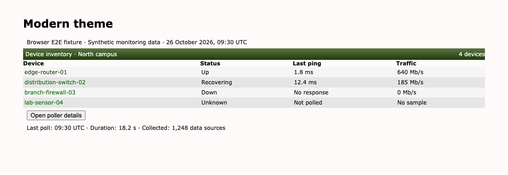
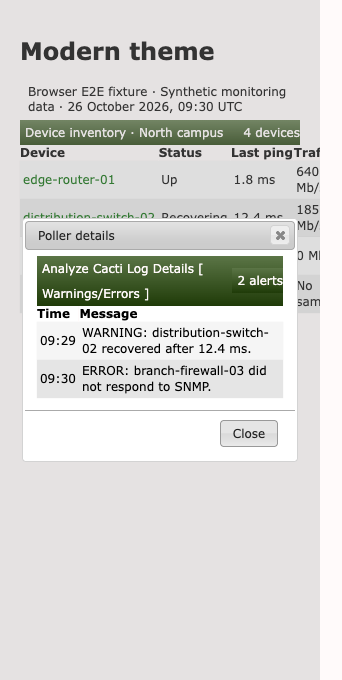

# Modern theme validation

Modern keeps long titles and controls inside their titlebars, restores visible
keyboard focus, and uses darker green text and gradient stops for readable links,
navigation, titles, and active controls. Short titlebars retain their 25px height.

## Populated browser fixtures

The browser loads the shipped Modern and jQuery UI stylesheets. Device names,
response times, traffic, and alert messages are synthetic monitoring data.
These fixtures do not require a running Cacti installation.



The browser follows a device link, opens a real jQuery UI details dialog at 320px,
checks its alert data and control bounds, and closes it.



## Reproduce

Use the dependency setup in [Cacti theme validation](cacti-theme.md), then run
from `tests/e2e`:

```sh
CACTI_THEME_COVERAGE=1 mise exec node@22 -- node node_modules/@playwright/test/cli.js test \
  tests/develop-theme-correctness.spec.ts tests/develop-theme-cleanup.spec.ts --project=chromium
```

Set `UPDATE_THEME_SCREENSHOTS=1` to regenerate screenshots. Tests cover native
title spans and controls at 320, 390, and 1280px, links across row states,
navigation hover, active controls, and keyboard focus with forced colors on/off.
Contrast checks compose alpha and sample sRGB gradient stops and interiors,
including legacy prefixed gradients. They do not prove contrast for arbitrary
image backgrounds or every pixel.

After committing, measure changed CSS line coverage from the repository root:

```sh
mise exec python@3.12 -- python tests/tools/report_changed_coverage.py \
  --base fix/midwinter-theme-accessibility --language css --minimum 100 \
  --browser-root tests/e2e/test-results
```

This layer extends the shared browser helpers above Midwinter in the native
theme stack. Use `origin/develop` after the lower layers merge. The gate measures
executed changed CSS lines, not whole-project or branch coverage.
