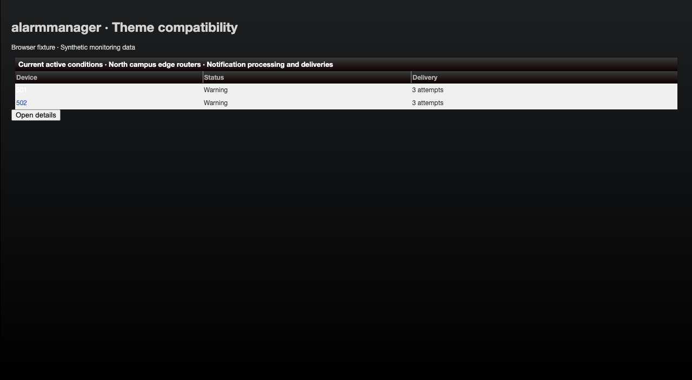
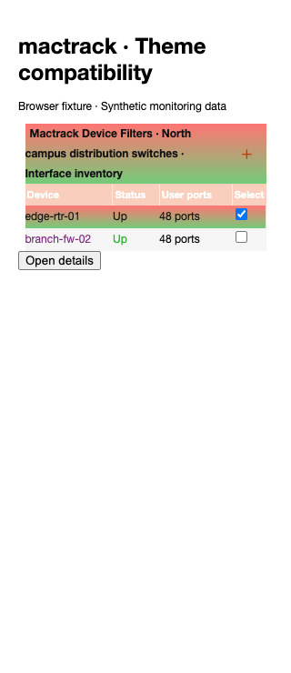
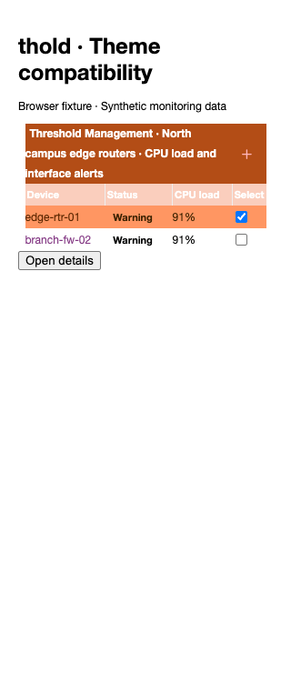
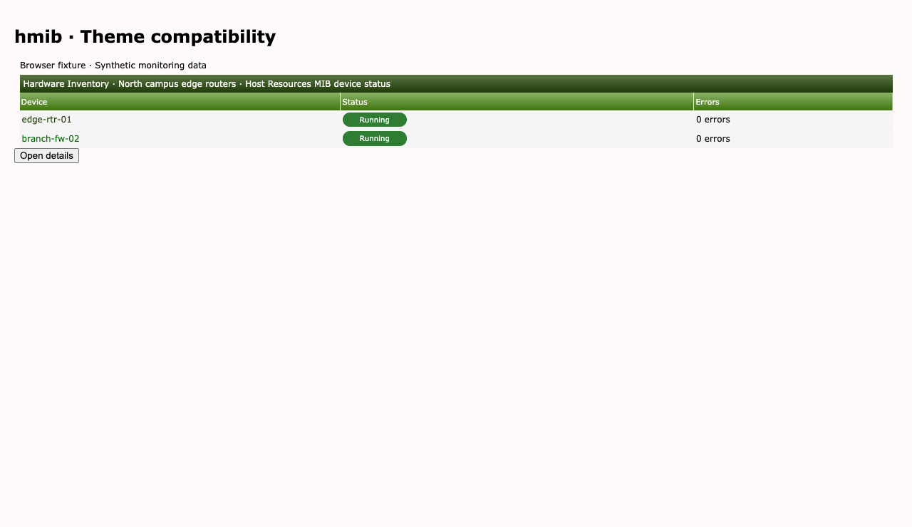
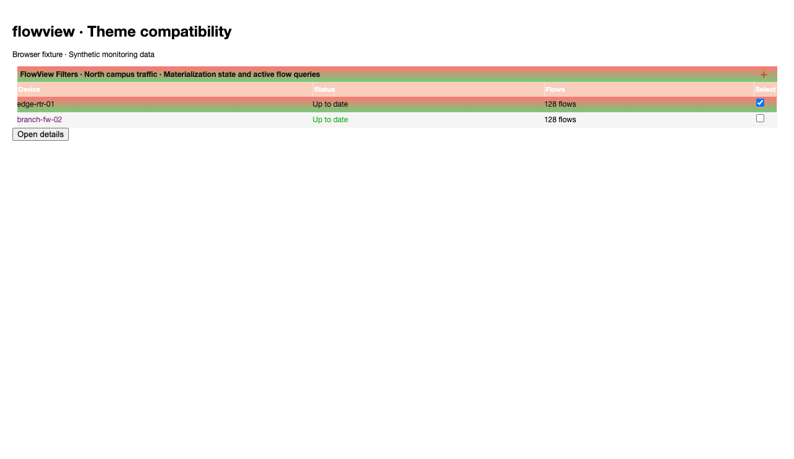
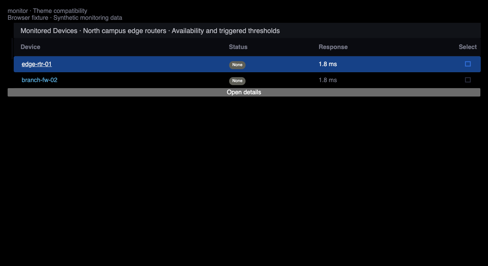

# Plugin theme compatibility

The browser matrix checks seven first-party plugins against all eleven Cacti
themes, including both Midwinter palettes: 84 plugin/theme combinations.
Carrot titles now wrap inside their bars, and Hollyberry uses its selected-row
foreground for shared Up status labels used by MacTrack and FlowView.

Syslog also needs its own result-surface correction. Its selected links must
keep the sampled foreground even when a host theme forces selected colors.
The pinned Syslog revision includes [the result-surface correction](https://github.com/Cacti/plugin_syslog/pull/429).

## Populated browser fixtures

Every fixture contains two synthetic devices or alarm events, status labels,
and measurements. Screenshots show representative browser components using
actual core and plugin stylesheets; they do not show a running plugin backend.














## Scope and revisions

The fixture reproduces `html_start_box` title/control order, representative row
and link classes, plugin status markup, and each plugin's stylesheet loading
order. Syslog runs its real `applySyslogTheme` JavaScript to sample host colors.
The generic details interaction opens and closes a real jQuery UI dialog.
Checkbox changes drive fixture selection state; the test does not run each
plugin's selection controller, authentication, database, or poller.

| Plugin | Pinned revision |
| --- | --- |
| thold | [`98ab70f31fe6`](https://github.com/Cacti/plugin_thold/tree/98ab70f31fe6bda7b91f5fa2baed82274caba0bb) |
| mactrack | [`d412b87460ba`](https://github.com/Cacti/plugin_mactrack/tree/d412b87460babebee573d2da973346d0dba8e94e) |
| syslog | [`e0ed9443b90c`](https://github.com/Cacti/plugin_syslog/tree/e0ed9443b90c500d01232c93e5db8ae375f98afd) |
| alarmmanager | [`92cf2c13d8e1`](https://github.com/Cacti/plugin_alarmmanager/tree/92cf2c13d8e14d3606bf9018025f07c22e4dc879) |
| hmib | [`4a22705d021b`](https://github.com/Cacti/plugin_hmib/tree/4a22705d021b11e1960377dfade5af601966c337) |
| flowview | [`be20ab796c61`](https://github.com/Cacti/plugin_flowview/tree/be20ab796c619465e78ce07d15e2babcb5d749c1) |
| monitor | [`564a17c7ea16`](https://github.com/Cacti/plugin_monitor/tree/564a17c7ea169ec24df3b869d7c44626db34ce2d) |

“Alertmanager” is represented here by Cacti Alarm Manager (`plugin_alarmmanager`).

Thold, MacTrack, Syslog, and Alarm Manager were requested explicitly. HMIB,
FlowView, and Monitor were selected from an eleven-repository activity survey
on 2026-10-26: their default branches had 245, 203, and 163 commits respectively
since 2026-09-26T00:00:00Z. This measures repository activity, not installation
counts. The survey also included ReportIt, Maint, MikroTik, ServCheck, WebSeer,
and Weathermap. GitHub's paginated repository commits API supplied the counts.

At 1280px and 320px, each case checks that the title and controls stay inside
the titlebar and saves a populated screenshot. Contrast measurements cover
links, status text, and applicable Add icons in resting, hovered, selected,
and selected-hovered states. Nonselectable report tables use resting/hovered
states only. Tests disable transitions to measure settled colors.

The comparison baseline is core commit
`883b334debc61c436e6ba140cf91863c7d6686b7`. Both sides load the same pinned
plugin code. Syslog result links and severity labels must reach 4.5:1; other
plugin measurements must not regress below their baseline or the applicable
4.5:1 text / 3:1 icon threshold. Existing plugin palette failures below those
thresholds remain visible in each `contrast-comparison.json`; passing this
matrix does not certify every existing plugin color as accessible. Raster
textures use their CSS fallback color in the contrast calculation.

## Reproduce

From the core repository root, create the pinned first-party checkouts:

```sh
python3 - <<'PYTHON'
import json
import pathlib
import subprocess

for plugin, revision in json.loads(pathlib.Path('tests/e2e/plugin-theme-revisions.json').read_text()).items():
    destination = pathlib.Path('.theme-plugins') / plugin
    subprocess.run(['git', 'clone', '--no-checkout', f'https://github.com/Cacti/plugin_{plugin}.git', str(destination)], check=True)
    subprocess.run(['git', '-C', str(destination), 'checkout', '--detach', revision], check=True)
PYTHON
mise exec node@22 -- npm ci --ignore-scripts --prefix tests/e2e
cd tests/e2e
mise exec node@22 -- npx --no-install playwright install chromium
mise exec node@22 -- npx --no-install playwright test --config playwright.theme.config.ts tests/develop-plugin-theme-compatibility.spec.ts --project=chromium
```

Use `CACTI_PLUGIN_FIXTURES` to select an existing checkout parent directory;
its children must be named by plugin ID. Tests verify every checkout's HEAD
against the manifest. The baseline commit must exist in the local core history.
CI uses immutable checkout references and uploads all comparison JSON and
screenshots alongside the ordinary theme coverage evidence. The existing core
coverage step still requires 100% of changed executable CSS lines.

See [GitHub Actions evidence](github-actions.md) for per-suite reports, artifact
retention, and screenshot refresh instructions.
