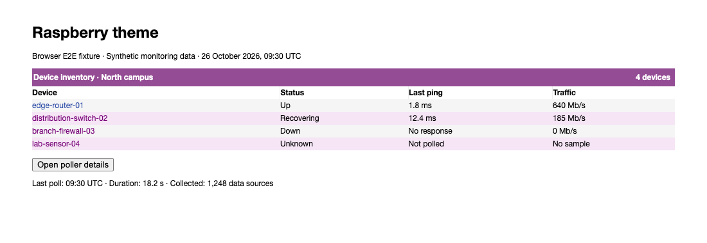
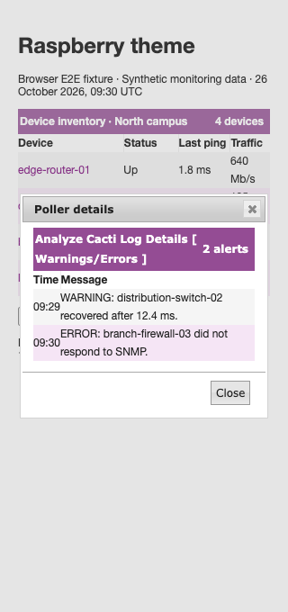

# Raspberry theme validation

Raspberry keeps wrapped titles beside their controls while preserving short 28px
bars, including padding. Darker purple edit links, menu text, and selected tabs
improve contrast. Selected rows retain yellow hover links, and table headings use
a less transparent purple background for readable white text.

## Populated browser fixtures

The browser loads the shipped Raspberry and jQuery UI stylesheets. Device names,
response times, traffic, and alert messages are synthetic monitoring data.
These fixtures do not require a running Cacti installation.



The browser follows a device link, opens a real jQuery UI details dialog at 320px,
checks its alert data and title bounds, and closes it.



## Reproduce

Use the dependency setup in [Cacti theme validation](cacti-theme.md), then run
from `tests/e2e`:

```sh
CACTI_THEME_COVERAGE=1 mise exec node@22 -- node node_modules/@playwright/test/cli.js test \
  tests/develop-theme-correctness.spec.ts tests/develop-theme-cleanup.spec.ts --project=chromium
```

Set `UPDATE_THEME_SCREENSHOTS=1` to regenerate screenshots. Tests cover native
title spans and controls at 320, 390, and 1280px, links across row states,
selected tabs, navigation, and active controls. Table headings are checked in
normal, selected, and hovered-column states. Contrast checks compose alpha
and sample sRGB gradient stops and interiors. They do not prove contrast for
arbitrary image backgrounds or every pixel.

After committing, measure changed CSS line coverage from the repository root:

```sh
mise exec python@3.12 -- python tests/tools/report_changed_coverage.py \
  --base fix/paw-theme-accessibility --language css --minimum 100 \
  --browser-root tests/e2e/test-results
```

This layer extends the shared browser helpers above Paw in the native theme
stack. Use `origin/develop` after the lower layers merge. The gate measures
executed changed CSS lines, not whole-project or branch coverage.
