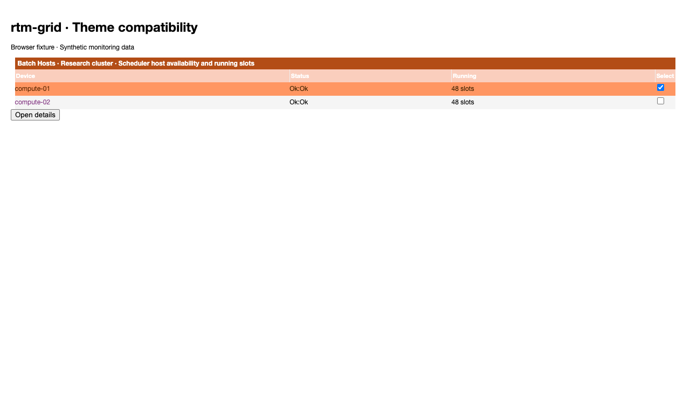
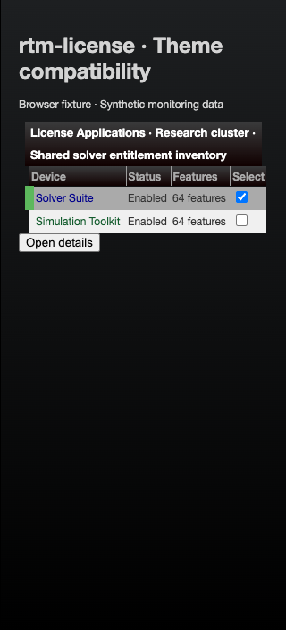
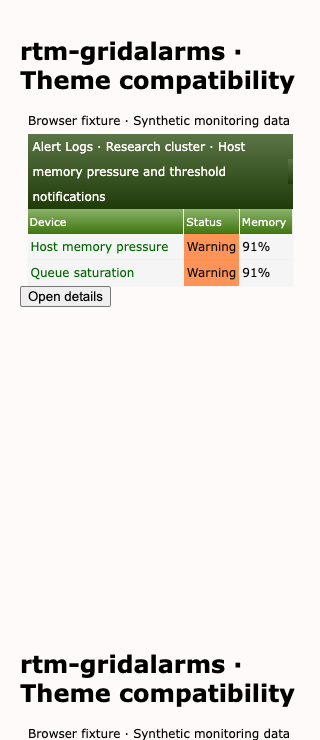

# RTM plugin theme compatibility

The RTM suite inventories all eighteen plugin directories in Larry Adams's
[RTM source repository](https://github.com/TheWitness/ibm-spectrum-lsf-rtm-server).
It tests fourteen table surfaces, the RTM console, GridPend filters, and the
LSF enhancement settings against all eleven Cacti themes, including both
Midwinter palettes. Project Mapping ships only demo setup/INFO files and has
no installable plugin UI at this revision.

## Populated fixtures








These are representative browser component fixtures with synthetic monitoring
data, not screenshots from a live scheduler, license server, database, or
poller. No RTM styles or scripts are copied into Cacti.

## Inventory and scope

All source references and CI checkouts are pinned to
`4b30a11e014805438cca47d13fae6bda8e28d2ac`. The inventory test fails when the source adds or removes a
plugin directory, when an entry point is missing, or when a different revision
is checked out. Bundled Syslog and Thold are tested separately from the newer
standalone Cacti plugins.

| Plugin | Covered surface | Entry point |
| --- | --- | --- |
| benchmark | Table and row-state fixture | [source](https://github.com/TheWitness/ibm-spectrum-lsf-rtm-server/blob/4b30a11e014805438cca47d13fae6bda8e28d2ac/cacti/plugins/benchmark/benchmark.php) |
| disku | Table and row-state fixture | [source](https://github.com/TheWitness/ibm-spectrum-lsf-rtm-server/blob/4b30a11e014805438cca47d13fae6bda8e28d2ac/cacti/plugins/disku/disku_applications.php) |
| exlist | Table and row-state fixture | [source](https://github.com/TheWitness/ibm-spectrum-lsf-rtm-server/blob/4b30a11e014805438cca47d13fae6bda8e28d2ac/cacti/plugins/exlist/exlists.php) |
| grid | Table and row-state fixture | [source](https://github.com/TheWitness/ibm-spectrum-lsf-rtm-server/blob/4b30a11e014805438cca47d13fae6bda8e28d2ac/cacti/plugins/grid/grid_bhosts.php) |
| gridalarms | Table and row-state fixture | [source](https://github.com/TheWitness/ibm-spectrum-lsf-rtm-server/blob/4b30a11e014805438cca47d13fae6bda8e28d2ac/cacti/plugins/gridalarms/lib/gridalarms_functions.php) |
| gridblstat | Table and row-state fixture | [source](https://github.com/TheWitness/ibm-spectrum-lsf-rtm-server/blob/4b30a11e014805438cca47d13fae6bda8e28d2ac/cacti/plugins/gridblstat/blstat_collectors.php) |
| gridcstat | Table and row-state fixture | [source](https://github.com/TheWitness/ibm-spectrum-lsf-rtm-server/blob/4b30a11e014805438cca47d13fae6bda8e28d2ac/cacti/plugins/gridcstat/gridcstat.php) |
| gridlimits | Table and row-state fixture | [source](https://github.com/TheWitness/ibm-spectrum-lsf-rtm-server/blob/4b30a11e014805438cca47d13fae6bda8e28d2ac/cacti/plugins/gridlimits/grid_limits.php) |
| heuristics | Table and row-state fixture | [source](https://github.com/TheWitness/ibm-spectrum-lsf-rtm-server/blob/4b30a11e014805438cca47d13fae6bda8e28d2ac/cacti/plugins/heuristics/grid_heuristics.php) |
| license | Table and row-state fixture | [source](https://github.com/TheWitness/ibm-spectrum-lsf-rtm-server/blob/4b30a11e014805438cca47d13fae6bda8e28d2ac/cacti/plugins/license/lic_applications.php) |
| lichist | Table and row-state fixture | [source](https://github.com/TheWitness/ibm-spectrum-lsf-rtm-server/blob/4b30a11e014805438cca47d13fae6bda8e28d2ac/cacti/plugins/lichist/grid_lichist.php) |
| meta | Table and row-state fixture | [source](https://github.com/TheWitness/ibm-spectrum-lsf-rtm-server/blob/4b30a11e014805438cca47d13fae6bda8e28d2ac/cacti/plugins/meta/metadata.php) |
| syslog | Table and row-state fixture | [source](https://github.com/TheWitness/ibm-spectrum-lsf-rtm-server/blob/4b30a11e014805438cca47d13fae6bda8e28d2ac/cacti/plugins/syslog/syslog.php) |
| thold | Table and row-state fixture | [source](https://github.com/TheWitness/ibm-spectrum-lsf-rtm-server/blob/4b30a11e014805438cca47d13fae6bda8e28d2ac/cacti/plugins/thold/thold.php) |
| RTM | Console summary and tiles | [source](https://github.com/TheWitness/ibm-spectrum-lsf-rtm-server/blob/4b30a11e014805438cca47d13fae6bda8e28d2ac/cacti/plugins/RTM/console.php) |
| gridpend | Filters and chart container; renderer unavailable | [source](https://github.com/TheWitness/ibm-spectrum-lsf-rtm-server/blob/4b30a11e014805438cca47d13fae6bda8e28d2ac/cacti/plugins/gridpend/grid_pend.php) |
| lsfenh | Registered RTM Plugins settings | [source](https://github.com/TheWitness/ibm-spectrum-lsf-rtm-server/blob/4b30a11e014805438cca47d13fae6bda8e28d2ac/cacti/plugins/lsfenh/setup.php) |
| projmap | Demo-only source; no installable setup.php | [source](https://github.com/TheWitness/ibm-spectrum-lsf-rtm-server/blob/4b30a11e014805438cca47d13fae6bda8e28d2ac/cacti/plugins/projmap/setup.php.demo) |

The common enabled-plugin stylesheet set includes RTM, Grid, GridAlarms,
Heuristics, the RTM Select2 overrides, and the bundled Thold theme stylesheet
when present. Lichist additionally loads its page stylesheet. This models those
plugins enabled together; plugin installation order and other combinations can
still affect styles. Classic and Spectrum are RTM-specific themes outside the
eleven core themes changed by this Cacti theme series.

The table cases share the existing plugin matrix runner. They compare resting,
hovered, and applicable selected states against the pinned core baseline, check
long titlebar geometry at 1280px and 320px, exercise a generic jQuery UI details
dialog, and retain screenshots and contrast JSON. Plain cluster names remain
plain text. Synthetic selection wiring does not run the RTM PHP/JavaScript
controllers. Existing contrast deficits are recorded under the same
[baseline policy](plugin-theme-compatibility.md); a passing comparison is not an
accessibility certification.

The console checks seeded host/cluster/job/license counts and tile navigation.
Settings checks change the real retention option values. GridPend checks cluster
and queue filters and its native chart-container identity.

**Chart limitation:** the public RTM checkout references FusionCharts and its
theme scripts but does not contain them. GridPend chart rendering and dashboard
chart labels/tooltips are not tested. No substitute chart renderer is used.
Full chart checks require the matching RTM runtime assets. Authentication,
backend requests, pollers, and scheduler/license-server integrations are also
outside these browser component fixtures.

The suite contains 204 plugin/theme cases plus one inventory check. This layer
changes tests and documentation only; the parent fix's 100% changed executable
CSS coverage gate remains in place. It does not claim 100% coverage of RTM code.

## Reproduce

After installing the existing Cacti browser tooling, from the repository root:

```sh
git clone --filter=blob:none --sparse https://github.com/TheWitness/ibm-spectrum-lsf-rtm-server.git .theme-plugins/rtm
git -C .theme-plugins/rtm sparse-checkout set cacti/plugins
git -C .theme-plugins/rtm checkout --detach 4b30a11e014805438cca47d13fae6bda8e28d2ac
cd tests/e2e
mise exec node@22 -- npx --no-install playwright test tests/develop-rtm-theme-compatibility.spec.ts tests/develop-rtm-surfaces.spec.ts --project=chromium --output rtm-compat-results
```

`CACTI_RTM_FIXTURE` may point to the `cacti` directory of an existing pinned
checkout. CI checks out the same immutable revision and uploads screenshots and
comparison JSON with the other theme evidence.
